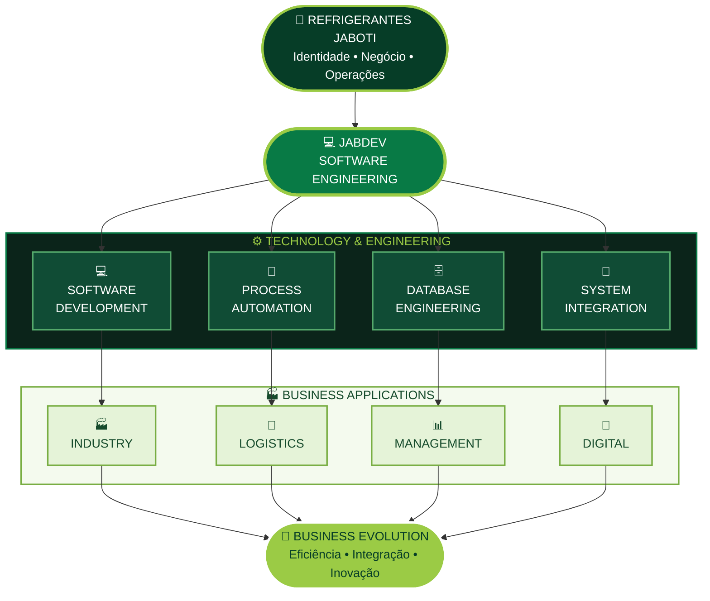

<!--
================================================================
 JABDEV | SOFTWARE ENGINEERING
 REFRIGERANTES JABOTI
================================================================
 Brand: JABDEV
 Organization: Refrigerantes Jaboti
 Focus: Software Engineering & Digital Innovation
================================================================
-->

<!-- ===================== HEADER ===================== -->

# JABDEV

### SOFTWARE ENGINEERING

**A tecnologia por trás da evolução da Jaboti.**

 

  

  

  <a href="#01-engineering">Engineering</a> •
  <a href="#02-technology-stack">Stack</a> •
  <a href="#03-digital-ecosystem">Ecossistema</a> •
  <a href="#04-jabdev-arcade">🎮 Arcade</a>

---

<!-- ===================== ABOUT ===================== -->

## WHO WE ARE

### Tecnologia, engenharia e inovação.

O **JABDEV** é a identidade de Engenharia de Software da **Refrigerantes Jaboti**, dedicada ao desenvolvimento de soluções tecnológicas, automação de processos e integração de sistemas.

Trabalhamos conectando tecnologia às necessidades reais da empresa, transformando desafios operacionais em soluções inteligentes, eficientes e sustentáveis.

Nossa atuação envolve desenvolvimento de aplicações, engenharia de dados, infraestrutura, automação e modernização de processos empresariais.

Mais do que desenvolver sistemas, buscamos construir ferramentas que simplifiquem operações, conectem informações e impulsionem a evolução tecnológica da Jaboti.

> **Nossa missão é transformar desafios em soluções através da tecnologia.**

---

<!-- ===================== ENGINEERING ===================== -->

# 01. ENGINEERING

### Engenharia aplicada a problemas reais.

Nossa engenharia é orientada pelas necessidades do negócio e pela busca contínua de eficiência operacional.

| ÁREA | ATUAÇÃO |
|:---|:---|
| 💻 **SOFTWARE DEVELOPMENT** | Desenvolvimento de aplicações, sistemas corporativos e ferramentas internas. |
| ⚙️ **PROCESS AUTOMATION** | Automação de tarefas, rotinas e processos empresariais. |
| 🗄️ **DATABASE ENGINEERING** | Modelagem, integração, consultas e gerenciamento de dados. |
| 🔗 **SYSTEM INTEGRATION** | Comunicação entre sistemas, serviços e plataformas. |
| 📱 **MOBILE DEVELOPMENT** | Aplicações móveis para colaboradores e operações externas. |
| 🖥️ **IT INFRASTRUCTURE** | Infraestrutura, conectividade, servidores e ambientes tecnológicos. |

---

<!-- ===================== TECHNOLOGY STACK ===================== -->

# 02. TECHNOLOGY STACK

### As tecnologias que impulsionam nossas soluções.

### SOFTWARE DEVELOPMENT

 

  

### DESKTOP & MOBILE DEVELOPMENT

  

### DATABASE ENGINEERING

  

### INFRASTRUCTURE & DEVELOPMENT TOOLS

---

<!-- ===================== DIGITAL ECOSYSTEM ===================== -->

# 03. DIGITAL ECOSYSTEM

### Um ecossistema. Diferentes soluções. Uma mesma direção.

O JABDEV conecta tecnologia, informação e operações, desenvolvendo soluções que apoiam a evolução digital da Refrigerantes Jaboti.

---

<!-- ===================== ARCADE ===================== -->

# 04. JABDEV ARCADE

### Bebeu, reciclou. Agora pule as garrafas PET!

  

  

<kbd>Espaço</kbd> / <kbd>↑</kbd> pular &nbsp;·&nbsp; <kbd>↓</kbd> abaixar &nbsp;·&nbsp; <kbd>P</kbd> pausa &nbsp;·&nbsp; 📱 toque para pular

---

<!-- ===================== FOOTER ===================== -->

**JABDEV · SOFTWARE ENGINEERING**

Refrigerantes Jaboti · Tecnologia que impulsiona a evolução.

  

